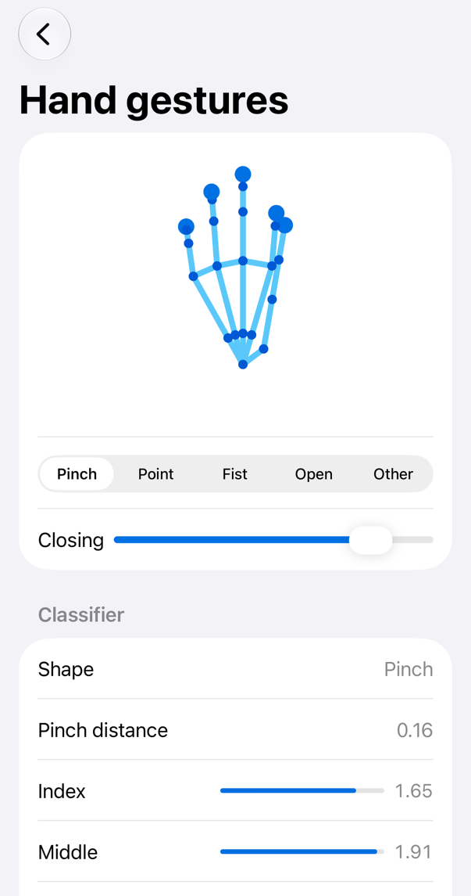
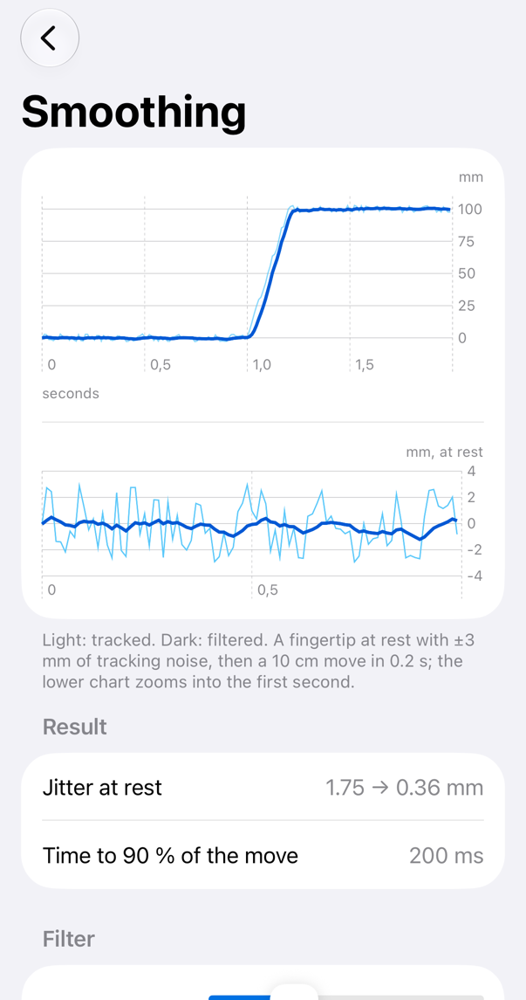
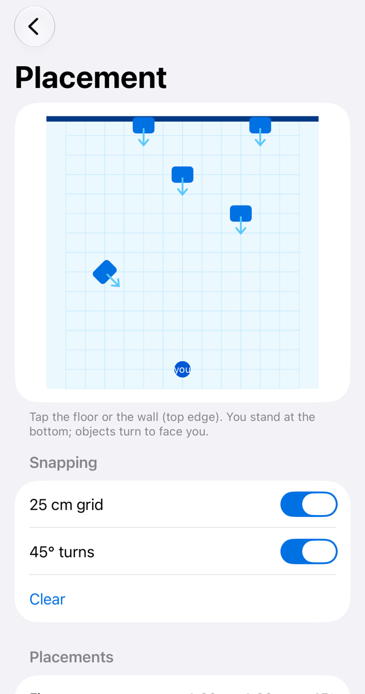
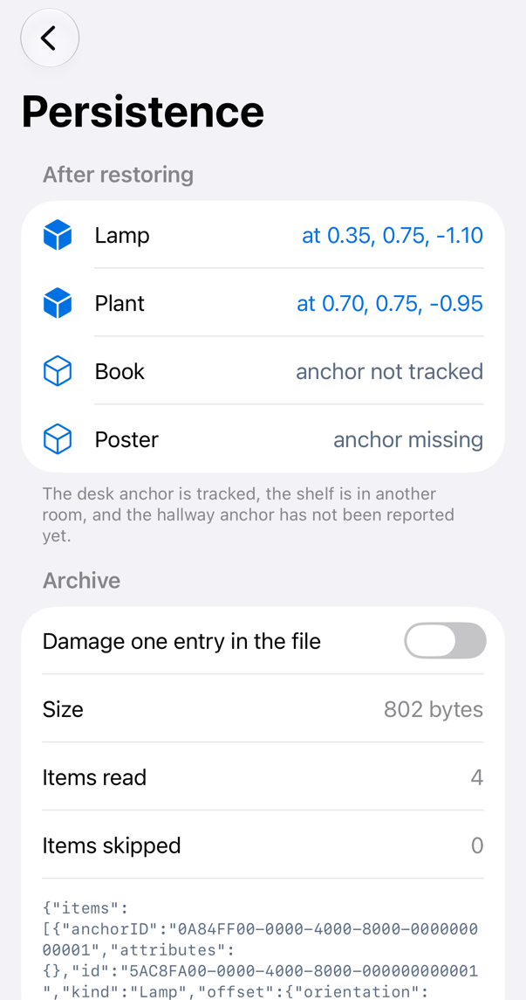
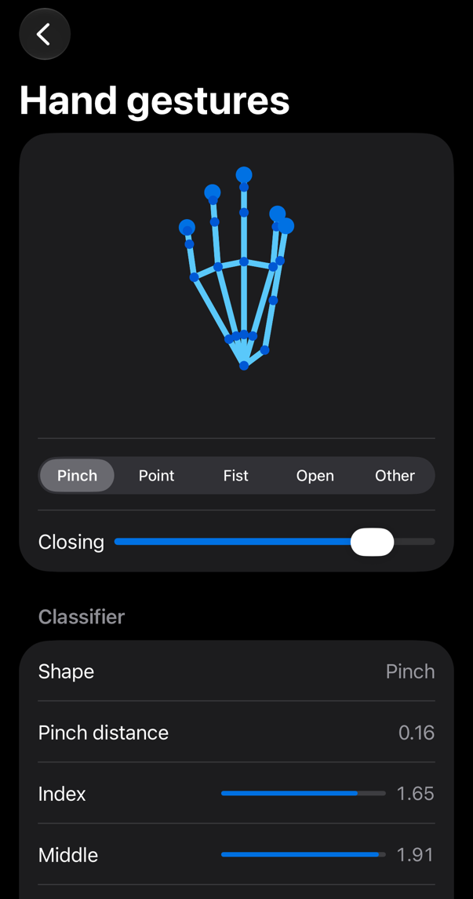
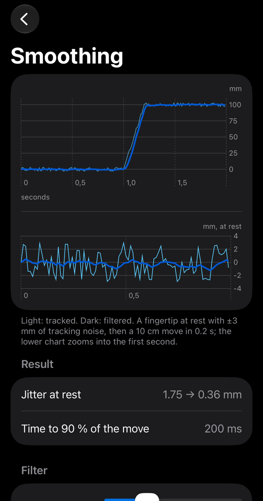
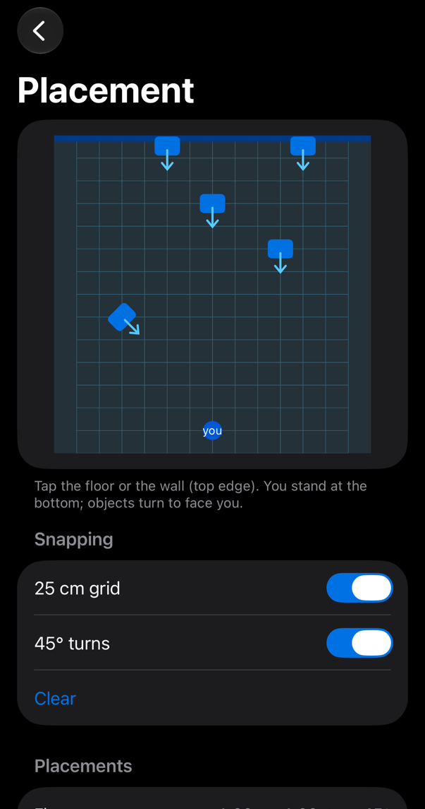
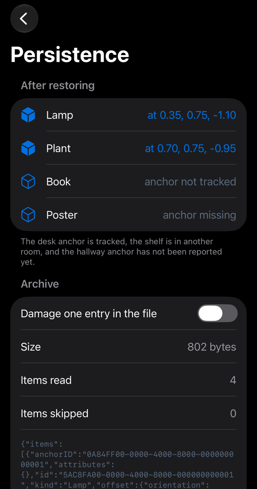

<!-- i18n-source: README.md@f321bb38071894405d44819e7cf9ff20c750b9cd status=reviewed -->
<!-- brand:start -->

<p align="center"><picture><source media="(prefers-color-scheme: dark)" srcset="https://raw.githubusercontent.com/muhittincamdali/ARCraft/main/.github/brand/banner-dark.svg"><source media="(prefers-color-scheme: light)" srcset="https://raw.githubusercontent.com/muhittincamdali/ARCraft/main/.github/brand/banner-light.svg"></picture></p>

<!-- lang-selector:start -->
<p align="center"><a href="README.md">English</a> · <a href="README.tr.md">Türkçe</a> · <a href="README.zh-CN.md">简体中文</a> · <a href="README.ja.md">日本語</a> · <a href="README.ko.md">한국어</a> · <a href="README.es.md">Español</a> · <a href="README.de.md">Deutsch</a> · <a href="README.fr.md">Français</a> · <a href="README.pt-BR.md">Português (Brasil)</a> · <a href="README.ru.md">Русский</a></p>
<!-- lang-selector:end -->

<p align="center">
<a href="https://github.com/muhittincamdali/ARCraft/actions/workflows/ci.yml"></a>
<a href="https://github.com/muhittincamdali/ARCraft/releases"><picture><source media="(prefers-color-scheme: dark)" srcset="https://raw.githubusercontent.com/muhittincamdali/ARCraft/main/.github/brand/badge-version-dark.svg"><source media="(prefers-color-scheme: light)" srcset="https://raw.githubusercontent.com/muhittincamdali/ARCraft/main/.github/brand/badge-version-light.svg"></picture></a>
<a href="https://github.com/muhittincamdali/ARCraft/blob/main/Package.swift"><picture><source media="(prefers-color-scheme: dark)" srcset="https://raw.githubusercontent.com/muhittincamdali/ARCraft/main/.github/brand/badge-platforms-dark.svg"><source media="(prefers-color-scheme: light)" srcset="https://raw.githubusercontent.com/muhittincamdali/ARCraft/main/.github/brand/badge-platforms-light.svg"></picture></a>
<a href="https://github.com/muhittincamdali/ARCraft/blob/main/Package.swift"><picture><source media="(prefers-color-scheme: dark)" srcset="https://raw.githubusercontent.com/muhittincamdali/ARCraft/main/.github/brand/badge-language-dark.svg"><source media="(prefers-color-scheme: light)" srcset="https://raw.githubusercontent.com/muhittincamdali/ARCraft/main/.github/brand/badge-language-light.svg"></picture></a>
<a href="https://github.com/muhittincamdali/ARCraft/blob/main/LICENSE"><picture><source media="(prefers-color-scheme: dark)" srcset="https://raw.githubusercontent.com/muhittincamdali/ARCraft/main/.github/brand/badge-license-dark.svg"><source media="(prefers-color-scheme: light)" srcset="https://raw.githubusercontent.com/muhittincamdali/ARCraft/main/.github/brand/badge-license-light.svg"></picture></a>
</p>

<p align="center">
<a href="#início-rápido"><picture><source media="(prefers-color-scheme: dark)" srcset="https://raw.githubusercontent.com/muhittincamdali/ARCraft/main/.github/brand/button-start-pt-BR-dark.svg"><source media="(prefers-color-scheme: light)" srcset="https://raw.githubusercontent.com/muhittincamdali/ARCraft/main/.github/brand/button-start-pt-BR-light.svg"></picture></a>
<a href="https://muhittincamdali.github.io/ARCraft/documentation/arcraft/"><picture><source media="(prefers-color-scheme: dark)" srcset="https://raw.githubusercontent.com/muhittincamdali/ARCraft/main/.github/brand/button-docs-pt-BR-dark.svg"><source media="(prefers-color-scheme: light)" srcset="https://raw.githubusercontent.com/muhittincamdali/ARCraft/main/.github/brand/button-docs-pt-BR-light.svg"></picture></a>
<a href="https://github.com/muhittincamdali/ARCraft/tree/main/Examples"><picture><source media="(prefers-color-scheme: dark)" srcset="https://raw.githubusercontent.com/muhittincamdali/ARCraft/main/.github/brand/button-examples-pt-BR-dark.svg"><source media="(prefers-color-scheme: light)" srcset="https://raw.githubusercontent.com/muhittincamdali/ARCraft/main/.github/brand/button-examples-pt-BR-light.svg"></picture></a>
</p>

> Esta é uma tradução do README em inglês. Se houver diferença, vale a versão em inglês.

<!-- brand:end -->

O ARCraft é um pacote Swift para apps de visionOS e iOS que usam rastreamento de mãos e world anchors. Ele não envolve o RealityKit: o RealityKit já renderiza, simula e manipula entidades. O ARCraft cobre o código que fica entre os dados brutos do ARKit e a sua cena, e que todo app espacial acaba escrevendo por conta própria: reconhecer uma pinça sem tremulação, manter estável o cursor na ponta do dedo, transformar um toque em uma mesa em uma pose em pé e alinhada à grade, e lembrar, de uma abertura do app para outra, qual conteúdo pertence a qual world anchor. O núcleo é Swift puro e `simd`, sem dependências, então ele roda e é testado no Mac, no simulador e nos previews; adaptadores enxutos o conectam ao ARKit no visionOS, à pose de mão do Vision no iOS e no macOS, e às entidades do RealityKit.

## Destaques

- **Gestos que não tremulam** — o `HandGestureRecognizer` adiciona debounce por quadro, uma distância de soltura maior para pinças e cancelamento quando o rastreamento é perdido, sobre um classificador de formas da mão independente de escala (pinça, apontar, punho, palma aberta) que funciona em metros (ARKit) e em pixels (Vision).
- **Filtragem de jitter** — `OneEuroFilter` e `PoseFilter` suavizam pontas dos dedos, pulsos e anchors com intensidade em repouso e de leve em movimento, e ignoram amostras NaN e timestamps fora de ordem.
- **Posicionamento em superfícies** — o `PlacementSolver` mantém o conteúdo em pé nas mesas, rente às paredes e voltado para quem olha, com encaixe opcional em grade e em passos de rotação; o `SpatialBounds` ajusta modelos de tamanho desconhecido a um volume.
- **Conteúdo que fica na sala** — `AnchoredItem`, `AnchorResolver` e `PlacementStore` registram o que foi posicionado em relação a qual `WorldAnchor` e leem o arquivo de volta como entrada não confiável: com limite de tamanho antes da análise, versionado, e uma entrada danificada não faz perder as demais.
- **Funciona sem headset** — o `SyntheticHand` cria poses de mão para o simulador, os previews e os testes; o `HandPose` é `Codable`, para gravação e reprodução.
- **Testado** — 103 testes do Swift Testing rodam no macOS e em um simulador de iPhone (105 no simulador do visionOS, incluindo os adaptadores do ARKit), e todo exemplo do README abaixo é compilado e executado pelo target de testes.

### O que está incluído

| Área | Tipos |
| --- | --- |
| Mãos | `HandPose`, `HandJoint`, `Finger`, `HandShapeClassifier`, `HandShapeReading`, `HandGestureRecognizer`, `HandGestureEvent`, `SyntheticHand` |
| Filtragem | `OneEuroFilter`, `OneEuroConfiguration`, `PoseFilter` |
| Posicionamento | `PlacementSolver`, `PlacementOptions`, `Placement`, `SurfaceHit`, `SurfaceOrientation`, `SpatialBounds`, `Entity.setPose(_:relativeTo:)`, `Entity.scaleToFit(_:allowsUpscaling:)` |
| Persistência | `AnchoredItem`, `WorldAnchorState`, `AnchorResolver`, `ItemStatus`, `PlacementArchive`, `PlacementStore` |
| Geometria | `Pose` (posição e quaternion unitário, `Codable`, rejeita NaN) |
| Adaptadores | `HandPose(_: HandAnchor, timestamp:)`, `WorldAnchorState(_: WorldAnchor)`, `AnchorResolver.apply(_:)` no visionOS; `HandPose(_: HumanHandPoseObservation, imageSize:timestamp:)` com o Vision |

## Início rápido

**1. Adicione o pacote**

No Xcode, escolha **File › Add Package Dependencies…** e informe a URL do repositório:

```text
https://github.com/muhittincamdali/ARCraft.git
```

Cole-o no campo de busca no canto superior direito da janela, defina **Dependency Rule** como **Branch** › `main` e clique em **Add Package**. Na janela seguinte, escolha o target do seu app ao lado de **ARCraft** e clique em **Add Package** de novo.

**2. Importe o módulo**

```swift
import ARCraft
```

Coloque esta linha no topo do arquivo Swift em que você usa o ARCraft.

**3. Use**

Adicione esta função a qualquer arquivo Swift do seu app (ou a um teste unitário) e chame `print(pinchDemo())`. Ela fecha e abre uma mão sintética a 90 quadros por segundo, então roda em qualquer dispositivo e no simulador:

```swift
func pinchDemo() -> [String] {
    var pinch = HandGestureRecognizer(configuration: .init(shape: .pinch))
    var log: [String] = []
    let closing: [Float] = [0, 0.3, 0.6, 0.9, 1, 1, 1, 0.6, 0.3, 0.1, 0]
    for (frame, amount) in closing.enumerated() {
        let pose = SyntheticHand.openPalm
            .interpolated(to: .pinch, fraction: amount)
            .pose(timestamp: Double(frame) / 90)
        for event in pinch.update(with: pose) {
            switch event {
            case .began: log.append("pinch began at frame \(frame)")
            case .ended: log.append("pinch ended at frame \(frame)")
            case .changed, .cancelled: break
            }
        }
    }
    return log
}
```

Ela imprime `["pinch began at frame 4", "pinch ended at frame 9"]`. A pinça começa no segundo quadro fechado e termina depois de três quadros abertos além da distância de soltura, e é isso que evita a tremulação. No Apple Vision Pro, você alimenta o mesmo recognizer com `HandPose(update.anchor, timestamp: update.timestamp)`, como mostrado em [Uso](#uso).

## Instalação

### Swift Package Manager

No Xcode, escolha **File › Add Package Dependencies…** e informe a URL do repositório:

```text
https://github.com/muhittincamdali/ARCraft.git
```

Em um manifesto `Package.swift`, adicione o pacote e o produto:

```swift
dependencies: [
    .package(url: "https://github.com/muhittincamdali/ARCraft.git", from: "1.1.0")
],
targets: [
    .target(name: "YourApp", dependencies: [
        .product(name: "ARCraft", package: "ARCraft")
    ])
]
```

A API descrita aqui é publicada na 1.1.0, a primeira versão com código-fonte da biblioteca. A tag anterior, `v1.0.0`, não contém nenhum (veja o [histórico de alterações](CHANGELOG.md)).

## Uso

Todos os exemplos abaixo foram copiados do [app de exemplo](Examples/ARCraftLab), que o CI compila para iOS, macOS e visionOS.

### Reconhecer pinças no Apple Vision Pro

Trecho de [`LiveSpaceModel.swift`](Examples/ARCraftLab/ARCraftLab/LiveSpaceModel.swift), que roda dentro de um `ImmersiveSpace` com `NSHandsTrackingUsageDescription` no Info.plist:

```swift
private func processHands() async {
    for await update in handTracking.anchorUpdates where update.anchor.chirality == .right {
        guard let pose = HandPose(update.anchor, timestamp: update.timestamp) else {
            if pinch.trackingLost(at: update.timestamp) == .cancelled { isPinching = false }
            fingertip = nil
            fingertipFilter.reset()
            continue
        }
        fingertip = pose[.indexFingerTip].flatMap { fingertipFilter.filter($0, at: update.timestamp) }
        for event in pinch.update(with: pose) {
            await handle(event)
        }
    }
}
```

`pinch` é um `HandGestureRecognizer(configuration: .init(shape: .pinch))`; quando a mão é perdida por mais tempo que a tolerância, o gesto é cancelado em vez de encerrado, então uma mão que sai do campo de visão nunca posiciona nada.

### Suavizar a ponta de um dedo

```swift
func smoothFingertip(_ samples: [(time: TimeInterval, position: SIMD3<Float>)]) -> [SIMD3<Float>] {
    var filter = OneEuroFilter<SIMD3<Float>>(configuration: .handJoints)
    return samples.compactMap { filter.filter($0.position, at: $0.time) }
}
```

### Posicionar conteúdo em uma mesa

```swift
func placeOnTable() throws -> Placement {
    let solver = PlacementSolver(options: .init(gridSize: 0.05, rotationStep: .pi / 4))
    let tap = SurfaceHit(position: SIMD3(0.42, 0.74, -0.81), normal: SIMD3(0, 1, 0))
    return try solver.place(on: tap, facing: SIMD3(0, 1.6, 0))
}
```

O conteúdo fica em pé em `(0.40, 0.74, -0.80)`, voltado para quem olha em passos de 45°. A frente dele é o eixo +Z, a convenção do USD. Em uma parede, ele ficaria rente à parede, virado para fora.

### Ajustar um modelo de tamanho desconhecido

```swift
func fitModel() -> Float {
    guard let bounds = SpatialBounds(min: SIMD3(-60, 0, -40), max: SIMD3(60, 90, 40)) else { return 1 }
    return bounds.scaleToFit(SIMD3(repeating: 0.3))
}
```

Retorna `0.0025`: um modelo criado com 120 unidades de largura passa a ter 30 cm de largura. Em uma entidade do RealityKit, chame `entity.scaleToFit(SIMD3(repeating: 0.3))` no lugar.

### Salvar o conteúdo posicionado e restaurá-lo

```swift
func saveAndRestore(in folder: URL) async throws -> [ItemStatus] {
    let store = PlacementStore(fileURL: folder.appendingPathComponent("room.json"))
    let anchor = WorldAnchorState(id: UUID(), pose: Pose(position: SIMD3(0, 0.8, -1)))
    let lamp = AnchoredItem(kind: "lamp", worldPose: Pose(position: SIMD3(0.2, 0.8, -1.1)), anchor: anchor)
    try await store.save([lamp])

    // Next launch: ARKit reports the anchor again and the store returns the items.
    var resolver = AnchorResolver()
    resolver.update(anchor)
    let restored = try await store.load().items
    return restored.map { resolver.status(of: $0) }
}
```

No visionOS, o anchor vem do `WorldTrackingProvider`. O espaço ao vivo associa o novo conteúdo a um anchor rastreado a até 50 cm, ou cria um:

```swift
private func place(kind: String, at worldPose: Pose) async {
    let anchor: WorldAnchorState
    if let nearby = resolver.nearestTrackedAnchor(to: worldPose.position, within: 0.5) {
        anchor = nearby
    } else {
        let worldAnchor = WorldAnchor(originFromAnchorTransform: worldPose.matrix)
        do {
            try await worldTracking.addAnchor(worldAnchor)
        } catch {
            status = .failed(error.localizedDescription)
            return
        }
        guard let state = WorldAnchorState(worldAnchor) else { return }
        resolver.update(state)
        anchor = state
    }
    items.append(AnchoredItem(kind: kind, worldPose: worldPose, anchor: anchor))
    do {
        try await store?.save(items)
    } catch {
        status = .failed(error.localizedDescription)
    }
}
```

## Demonstração

Telas do [app de exemplo](Examples/ARCraftLab), capturadas no simulador do iOS pelo [`scripts/capture-example-screens.sh`](scripts/capture-example-screens.sh). Cada uma executa o ARCraft com dados sintéticos ou gravados.

| Gestos de mão | Suavização | Posicionamento | Persistência |
| --- | --- | --- | --- |
|  |  |  |  |
|  |  |  |  |

## Documentação

- [Referência da API](https://muhittincamdali.github.io/ARCraft/documentation/arcraft/) (DocC, publicada no GitHub Pages a partir da `main`)
- Compile-a localmente no Xcode com **Product › Build Documentation**, ou pela linha de comando:

```sh
xcodebuild docbuild -scheme ARCraft -destination 'generic/platform=visionOS Simulator'
```

## Guias

- [Getting Started](https://muhittincamdali.github.io/ARCraft/documentation/arcraft/gettingstarted)
  — adicione o pacote e reconheça uma pinça com dados sintéticos e depois com dados do ARKit
  ([código-fonte](Sources/ARCraft/ARCraft.docc/GettingStarted.md)).
- [Recognizing Hand Gestures](https://muhittincamdali.github.io/ARCraft/documentation/arcraft/recognizinghandgestures)
  — como as formas são medidas, debounce, histerese, perda de rastreamento, duas mãos e o Vision no iOS
  ([código-fonte](Sources/ARCraft/ARCraft.docc/RecognizingHandGestures.md)).
- [Smoothing Tracking Data](https://muhittincamdali.github.io/ARCraft/documentation/arcraft/smoothingtrackingdata)
  — ajustar o filtro One Euro e suavizar poses
  ([código-fonte](Sources/ARCraft/ARCraft.docc/SmoothingTrackingData.md)).
- [Placing Content on Surfaces](https://muhittincamdali.github.io/ARCraft/documentation/arcraft/placingcontentonsurfaces)
  — pisos, paredes, encaixe e ajuste de modelos
  ([código-fonte](Sources/ARCraft/ARCraft.docc/PlacingContentOnSurfaces.md)).
- [Persisting Placed Content](https://muhittincamdali.github.io/ARCraft/documentation/arcraft/persistingplacedcontent)
  — world anchors, restauração na abertura, limpeza e os limites do formato do arquivo
  ([código-fonte](Sources/ARCraft/ARCraft.docc/PersistingPlacedContent.md)).
- [Testing Without a Headset](https://muhittincamdali.github.io/ARCraft/documentation/arcraft/testingwithoutaheadset)
  — mãos sintéticas e gravadas, e anchors em testes unitários
  ([código-fonte](Sources/ARCraft/ARCraft.docc/TestingWithoutAHeadset.md)).

## Requisitos

| Plataforma | Versão mínima |
| --- | --- |
| iOS | 18 |
| macOS | 15 |
| visionOS | 2 |
| Ferramentas | Swift 6.2 · Xcode 26+ |

O rastreamento de mãos e do mundo exige o Apple Vision Pro; os adaptadores do ARKit só compilam para visionOS. O CI compila com o Xcode padrão da imagem de runner `macos-26` do GitHub. O pacote é desenvolvido com o Xcode 27, usando os SDKs do iOS 27 e do visionOS 27.

## Quando usar outra coisa

- **Mover, girar e redimensionar entidades com os gestos padrão:** o `ManipulationComponent` do RealityKit (visionOS 26) e o `GestureComponent` fazem isso sem código extra.
- **Comparar poses estáticas de mão personalizadas por similaridade:** o [HandVector](https://github.com/XanderXu/HandVector) compara vetores das articulações da mão inteira com modelos gravados; o ARCraft classifica quatro formas fixas com limiares explícitos.
- **Gestos semânticos como modificadores do SwiftUI (palmas, estalo de dedos, soco):** [HandGesture](https://github.com/johnhaney/HandGesture).
- **Controles de interface 3D (interruptores, controles deslizantes, botões como entidades):** [RealityUI](https://github.com/maxxfrazer/RealityUI).

## Arquitetura

- `Sources/ARCraft/Math`, `Filtering`, `Hands`, `Placement` e `Persistence` são tipos de valor que usam apenas Foundation e `simd`. O `PlacementStore` é o único tipo de referência (um actor que serializa o acesso a arquivos).
- `Sources/ARCraft/Platform` contém os adaptadores: `ARKit+ARCraft.swift` (somente visionOS) e `Vision+ARCraft.swift`. `Placement/Entity+ARCraft.swift` adiciona os auxiliares do RealityKit.
- Todo tipo que aceita entrada externa a valida na fronteira: matrizes e números decodificados precisam ser finitos, os valores de configuração são limitados, coleções e arquivos têm limites de tamanho, e nomes de arquivo não podem sair da pasta do app.
- Os testes ficam em `Tests/ARCraftTests` (Swift Testing). O classificador de mãos é testado com fixtures de articulações digitadas à mão e também com mãos sintéticas, para que os dois não apenas concordem entre si.

Execute os testes localmente:

```sh
swift test                                    # macOS
xcodebuild test -scheme ARCraft \
  -destination 'platform=iOS Simulator,name=iPhone 17 Pro'
xcodebuild test -scheme ARCraft \
  -destination 'platform=visionOS Simulator,name=Apple Vision Pro'
```

## Roteiro

- Criar a tag da versão 2.0.0 e adicionar o pacote ao Swift Package Index; o `.spi.yml` já está no repositório.
- Gestos com duas mãos (escalar e girar entre as duas pinças) sobre o `HandGestureRecognizer`.
- Posicionamento pela extensão dos plane anchors, para que o conteúdo fique dentro das bordas de uma mesa detectada.

## Como contribuir

Contribuições são bem-vindas. Leia o [guia de contribuição](https://github.com/muhittincamdali/ARCraft/blob/main/CONTRIBUTING.md) e o [código de conduta](https://github.com/muhittincamdali/.github/blob/main/CODE_OF_CONDUCT.md) antes de abrir um pull request. Relate problemas de segurança de forma privada, como descrito na [política de segurança](https://github.com/muhittincamdali/.github/blob/main/SECURITY.md).

## Licença

Publicado sob a licença MIT. Veja [LICENSE](LICENSE).
